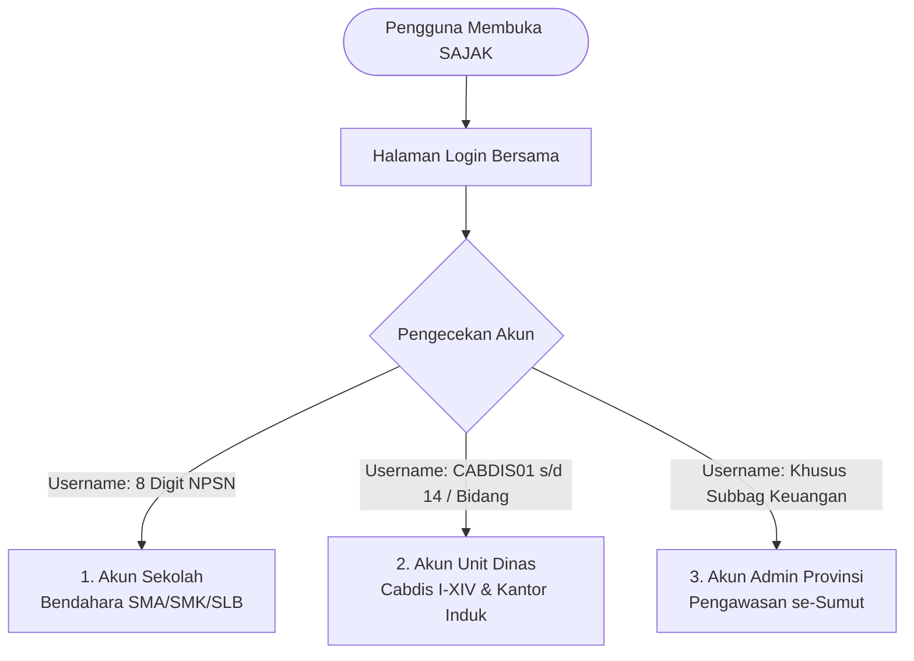
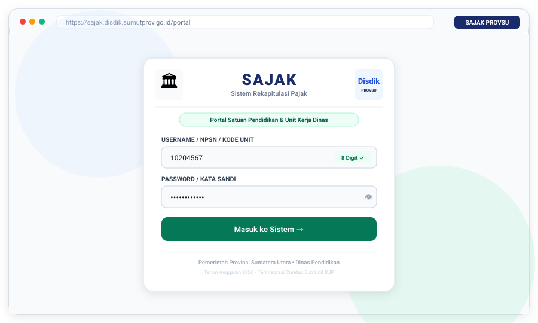
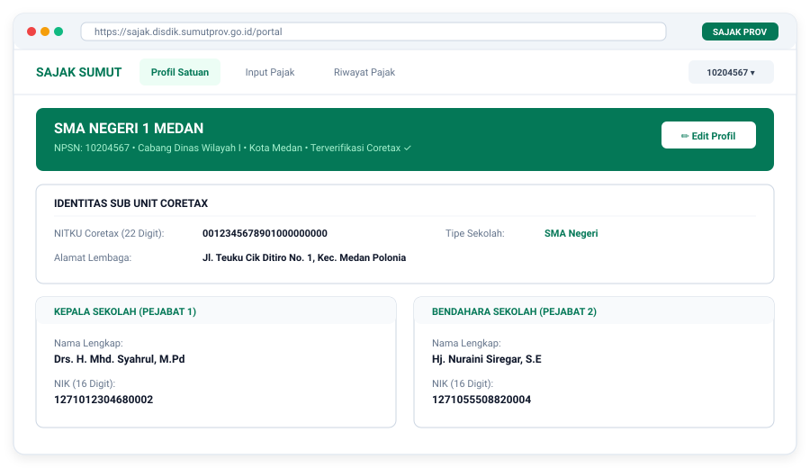
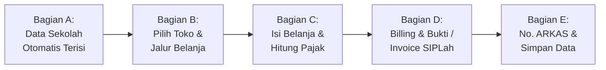
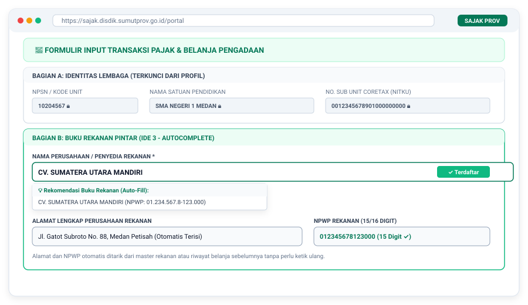
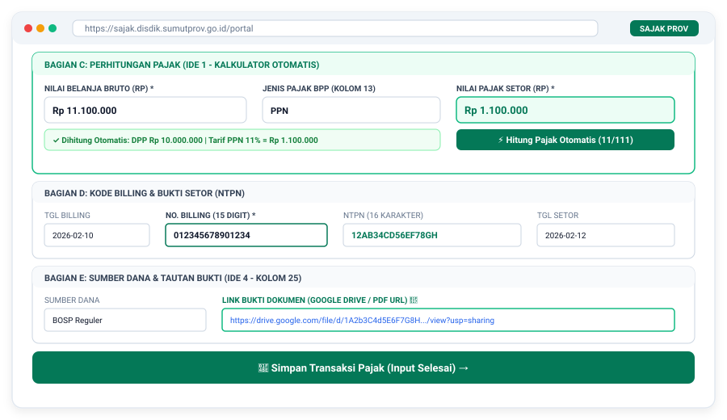
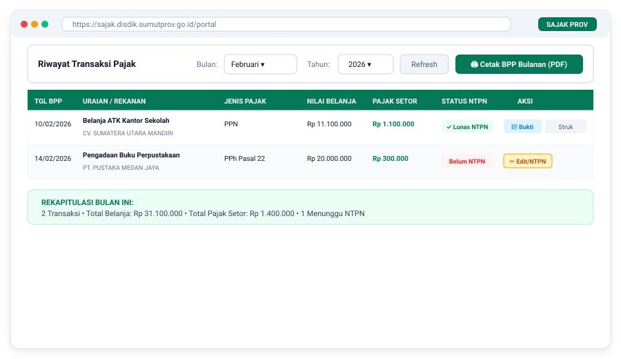
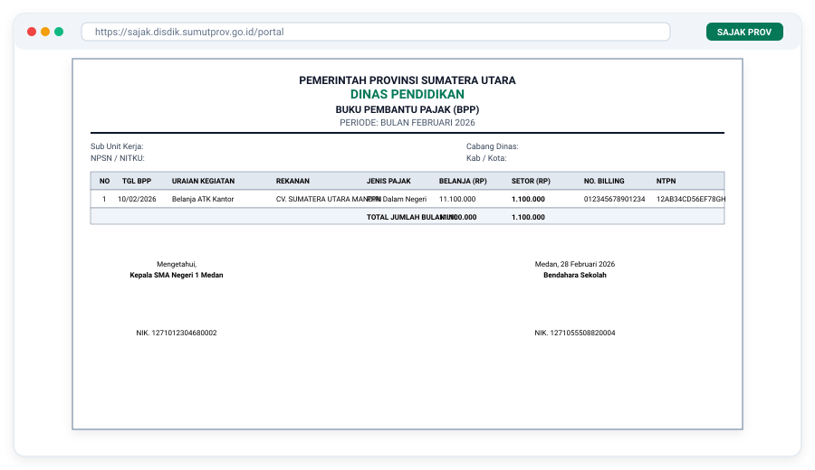
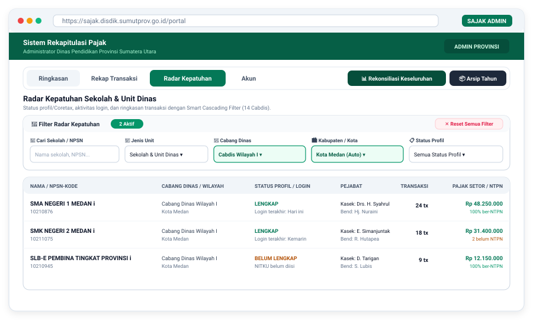
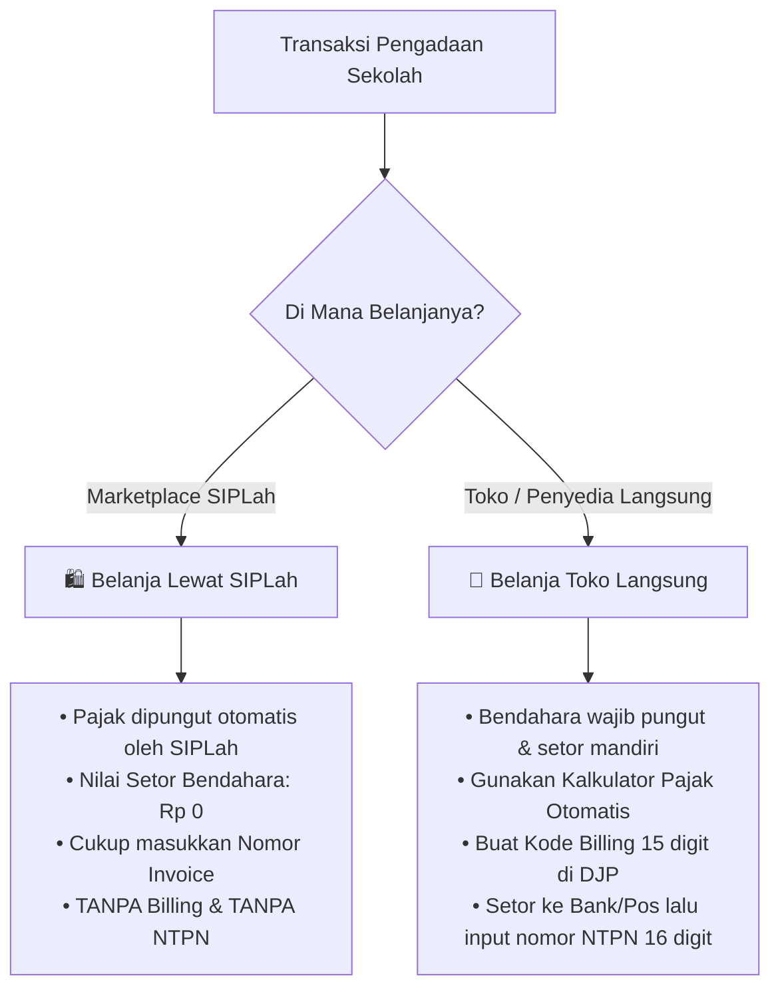

# 📘 BUKU PANDUAN PENGGUNAAN APLIKASI SAJAK
## SISTEM REKAPITULASI PAJAK & BUKU PEMBANTU PAJAK (BPP)
### DINAS PENDIDIKAN PROVINSI SUMATERA UTARA

> **Edisi:** Panduan Praktis & Bergambar untuk Pengguna Awam  
> **Tahun Anggaran:** 2026 (Terintegrasi Standar Coretax DJP)  
> **Sasaran Pembaca:** Bendahara Sekolah (SMA/SMK/SLB Negeri), Operator Cabang Dinas & Bidang, serta Pengelola Keuangan Dinas Pendidikan Provinsi  

---

## 📌 DAFTAR ISI

1. [BAB I: MENGENAL APLIKASI SAJAK](#bab-i-mengenal-aplikasi-sajak)
   - [1.1 Apa Itu SAJAK?](#11-apa-itu-sajak)
   - [1.2 Manfaat Utama untuk Bendahara & Instansi](#12-manfaat-utama-untuk-bendahara--instansi)
   - [1.3 Tiga Jenis Akun Pengguna](#13-tiga-jenis-akun-pengguna)
2. [BAB II: PANDUAN PRAKTIS BENDAHARA SEKOLAH (SMA / SMK / SLB)](#bab-ii-panduan-praktis-bendahara-sekolah-sma--smk--slb)
   - [2.1 Cara Masuk (Login) ke Aplikasi](#21-cara-masuk-login-ke-aplikasi)
   - [2.2 Langkah Pertama: Mengisi Profil Sekolah](#22-langkah-pertama-mengisi-profil-sekolah)
   - [2.3 Cara Mencatat Transaksi Pajak (Formulir Input)](#23-cara-mencatat-transaksi-pajak-formulir-input)
   - [2.4 Transaksi Khusus Belanja Melalui SIPLah (Cukup No. Invoice)](#24-transaksi-khusus-belanja-melalui-siplah-cukup-no-invoice)
   - [2.5 Menghitung Pajak Otomatis (Tanpa Rumus Manual)](#25-menghitung-pajak-otomatis-tanpa-rumus-manual)
   - [2.6 Menyimpan Tautan Bukti Dokumen (Google Drive / PDF)](#26-menyimpan-tautan-bukti-dokumen-google-drive--pdf)
   - [2.7 Melihat Riwayat & Menyusulkan Nomor NTPN](#27-melihat-riwayat--menyusulkan-nomor-ntpn)
   - [2.8 Fitur Cepat 1: Susul NTPN Massal Sekaligus](#28-fitur-cepat-1-susul-ntpn-massal-sekaligus)
   - [2.9 Fitur Cepat 2: Impor BKU dari ARKAS 4 (Hitungan Detik)](#29-fitur-cepat-2-impor-bku-dari-arkas-4-hitungan-detik)
   - [2.10 Mencetak Buku Pembantu Pajak (BPP) Bulanan untuk SPJ](#210-mencetak-buku-pembantu-pajak-bpp-bulanan-untuk-spj)
   - [2.11 Pengaman Isian Otomatis (Anti-Hilang saat Mati Lampu)](#211-pengaman-isian-otomatis-anti-hilang-saat-mati-lampu)
3. [BAB III: PANDUAN OPERATOR CABANG DINAS & BIDANG](#bab-iii-panduan-operator-cabang-dinas--bidang)
   - [3.1 Karakteristik Akun Unit Dinas (3 Pejabat: KPA, PPTK, BPP)](#31-karakteristik-akun-unit-dinas-3-pejabat-kpa-pptk-bpp)
   - [3.2 Pencatatan Belanja APBD & E-Katalog LKPP](#32-pencatatan-belanja-apbd--e-katalog-lkpp)
   - [3.3 Dashboard Pengawasan Sekolah Binaan Cabang Dinas](#33-dashboard-pengawasan-sekolah-binaan-cabang-dinas)
4. [BAB IV: PANDUAN PENGELOLA PROVINSI (ADMIN KEANGAN DINAS)](#bab-iv-panduan-pengelola-provinsi-admin-keuangan-dinas)
   - [4.1 Dashboard Pengawasan Keuangan se-Sumut](#41-dashboard-pengawasan-keuangan-se-sumut)
   - [4.2 Radar Kepatuhan Profil & Pajak Sekolah](#42-radar-kepatuhan-profil--pajak-sekolah)
   - [4.3 Rekap Transaksi & Unduh Berkas Excel Rapi (.xls)](#43-rekap-transaksi--unduh-berkas-excel-rapi-xls)
   - [4.4 Paket Rekonsiliasi Keseluruhan untuk Audit BPK / Inspektorat](#44-paket-rekonsiliasi-keseluruhan-untuk-audit-bpk--inspektorat)
   - [4.5 Pengelolaan Akun Pengguna](#45-pengelolaan-akun-pengguna)
5. [BAB V: PANDUAN SINGKAT ATURAN PAJAK BELANJA](#bab-v-panduan-singkat-aturan-pajak-belanja)
   - [5.1 Tabel Ringkas Jenis Pajak & Kapan Harus Dipotong](#51-tabel-ringkas-jenis-pajak--kapan-harus-dipotong)
   - [5.2 Perbedaan Penting Belanja SIPLah vs Toko Langsung](#52-perbedaan-penting-belanja-siplah-vs-toko-langsung)
   - [5.3 Daftar Jumlah Digit Penting yang Wajib Pas](#53-daftar-jumlah-digit-penting-yang-wajib-pas)
6. [BAB VI: TANYA JAWAB & SOLUSI KENDALA (FAQ)](#bab-vi-tanya-jawab--solusi-kendala-faq)
7. [BAB VII: CARA MEMPERBARUI FOTO TAMPILAN SISTEM](#bab-vii-cara-memperbarui-foto-tampilan-sistem)

---

## BAB I: MENGENAL APLIKASI SAJAK

### 1.1 Apa Itu SAJAK?
**SAJAK (Sistem Rekapitulasi Pajak)** adalah aplikasi web resmi Dinas Pendidikan Provinsi Sumatera Utara yang dibuat khusus untuk membantu **Bendahara Sekolah (SMA/SMK/SLB)** dan **Bendahara Unit Dinas/Cabdis** dalam:
1. Mencatat belanja pengadaan barang/jasa beserta pajaknya secara tertib.
2. Menghitung nilai potongan pajak secara otomatis tanpa pusing menghitung manual.
3. Mencetak **Buku Pembantu Pajak (BPP) Bulanan** resmi format A4 Landscape yang langsung siap ditandatangani untuk kelengkapan SPJ.
4. Menyelaraskan data sekolah dengan sistem perpajakan terbaru dari Direktorat Jenderal Pajak (**Coretax DJP**).

Aplikasi ini dapat diakses dengan mudah melalui peramban internet (*Google Chrome, Microsoft Edge, Mozilla Firefox*) di laptop maupun komputer tanpa perlu menginstal aplikasi tambahan apa pun.

---

### 1.2 Manfaat Utama untuk Bendahara & Instansi
* **Bebas Salah Hitung Pajak**: Cukup masukkan nilai belanja, klik satu tombol, nilai pajak terhitung otomatis sesuai peraturan perundang-undangan terbaru.
* **Belanja SIPLah Lebih Ringkas**: Transaksi melalui SIPLah tidak memerlukan Kode Billing, Faktur, atau NTPN. Bendahara cukup memasukkan **Nomor Invoice**, beres!
* **Bisa Impor Langsung dari ARKAS 4**: Jika sekolah menggunakan ARKAS, cukup ekspor BKU ke Excel lalu unggah ke SAJAK. Puluhan transaksi langsung masuk otomatis dalam hitungan detik.
* **Cetak BPP Bulanan Otomatis**: Tidak perlu lagi membuat lembar BPP manual di Excel berulang-ulang setiap bulan.
* **Bukti Setor Aman Digital**: Kuitansi, lembar billing, dan bukti NTPN dapat disimpan tautannya (link Google Drive) sehingga tidak akan tercecer saat pemeriksaan BPK atau Inspektorat.

---

### 1.3 Tiga Jenis Akun Pengguna

1. **Akun Sekolah (Operator / Bendahara Sekolah)**:
   * **Username**: 8 digit **NPSN** sekolah (contoh: `10204567`).
   * **Tugas**: Mengisi profil sekolah (Kepala Sekolah & Bendahara), mencatat transaksi pajak, menyusulkan NTPN, dan mencetak lembar BPP bulanan sekolah.
2. **Akun Unit Dinas (Cabang Dinas & Bidang Kantor Induk)**:
   * **Username**: Kode resmi unit (contoh: `CABDIS01` s/d `CABDIS14`, `SEKRETARIAT`, `BID-SMA`, dll.).
   * **Tugas**: Mencatat belanja kantor dinas/cabdis dan mengawasi kepatuhan sekolah-sekolah binaan di wilayah kerjanya.
3. **Akun Admin Provinsi (Subbagian Keuangan & Program Provsu)**:
   * **Tugas**: Memantau realisasi belanja dan setoran pajak seluruh 746 sekolah dan 20 unit kerja se-Sumut, serta menyiapkan dokumen rekonsiliasi untuk audit BPK dan Inspektorat.

---

## BAB II: PANDUAN PRAKTIS BENDAHARA SEKOLAH (SMA / SMK / SLB)

### 2.1 Cara Masuk (Login) ke Aplikasi
1. Buka tautan resmi aplikasi SAJAK pada browser (disarankan menggunakan **Google Chrome** di laptop/komputer).
2. Layar login akan tampil bersih dengan identitas **🏛️ Portal Satuan Pendidikan & Unit Kerja Dinas**.
3. Pada kotak **Username / NPSN / Kode Unit**, ketik **8 digit NPSN** sekolah Anda (contoh: `10210455`) atau kode unit dinas (contoh: `CABDIS01`).
   > [!NOTE]  
   > Sistem memiliki indikator validasi cerdas serta memastikan latar belakang aplikasi tetap terlindungi penuh sebelum login berhasil.
4. Pada kotak **Password / Kata Sandi**, masukkan kata sandi akun Anda (tersedia ikon mata 👁️ di sisi kanan untuk menampilkan/menyembunyikan sandi).
5. Klik tombol hijau **[Masuk ke Sistem →]**.

*Gambar 2.1: Layar Login SAJAK dengan kotak isian NPSN 8 digit.*

---

### 2.2 Langkah Pertama: Mengisi Profil Sekolah
> [!IMPORTANT]  
> Saat pertama kali login, sistem akan meminta Anda melengkapi data profil terlebih dahulu. Menu input pajak akan terbuka otomatis setelah profil disimpan.

1. Buka menu **Profil Sekolah**.
2. Data identitas sekolah (Nama Sekolah, Alamat, Kabupaten/Kota, Cabang Dinas, dan Nomor NITKU Coretax 22 digit) telah terisi otomatis dari sistem.
3. Lengkapi data **Dua Pejabat Penanggung Jawab**:
   * **Kepala Sekolah**: Isi Nama Lengkap (beserta gelar) dan **NIK KTP (tepat 16 digit angka)**.
   * **Bendahara Sekolah**: Isi Nama Lengkap (beserta gelar) dan **NIK KTP (tepat 16 digit angka)**.
4. Klik tombol hijau **[💾 Simpan Profil Satuan Pendidikan]**.
5. Setelah berhasil disimpan, profil akan terkunci rapi (*View Mode*). Nama pejabat ini akan otomatis tercantum pada setiap lembar BPP bulanan yang Anda cetak.

*Gambar 2.2: Tampilan Profil Sekolah yang sudah tersimpan lengkap.*

---

### 2.3 Cara Mencatat Transaksi Pajak (Formulir Input)
Klik menu **Input Pajak**. Formulir terbagi menjadi beberapa bagian sederhana:

1. **Bagian A (Identitas Sekolah)**: Sudah terisi otomatis, tidak perlu diubah.
2. **Bagian B (Detail Kegiatan & Rekanan/Toko)**:
   * **Jalur Belanja Pengadaan**: Tentukan apakah belanja dilakukan lewat **SIPLah** atau **Toko Langsung (di luar SIPLah)**.
   * **Uraian Kegiatan**: Tulis ringkas belanja apa yang dilakukan (contoh: *Belanja ATK dan Penggandaan Soal Ujian BOS Reguler*).
   * **Nama Perusahaan / Rekanan**: Ketik nama toko/penyedia.
     > [!TIP] **Buku Rekanan Pintar (Otomatis)**  
     > Jika Anda pernah berbelanja di toko tersebut sebelumnya, sistem akan menampilkan pilihan toko. Klik nama toko tersebut, maka **Alamat** dan **NPWP Rekanan** akan **terisi otomatis** tanpa perlu Anda ketik ulang!

*Gambar 2.3: Formulir Input Pajak dan fitur pengisian otomatis alamat toko.*

---

### 2.4 Transaksi Khusus Belanja Melalui SIPLah (Cukup No. Invoice)
Sesuai aturan Menteri Keuangan (**PMK No. 58/PMK.03/2022**), seluruh pajak belanja melalui SIPLah (PPN 11% dan PPh 22 0,5%) **otomatis dipungut dan disetor langsung oleh mitra marketplace SIPLah** (seperti Blibli, Siplah Telkom, PesonaEdu, Intan Pariwara, dll.).

**Keuntungan bagi Bendahara di SAJAK:**
1. Pada pilihan *Jalur Belanja Pengadaan*, pilih:  
   👉 **Belanja Melalui SIPLah (Marketplace Resmi Kemendikbud)**.
2. Sistem secara cerdas akan **menyembunyikan** kolom-kolom yang tidak diperlukan:
   * ❌ Tidak perlu mengisi Kode Billing
   * ❌ Tidak perlu Faktur Pajak
   * ❌ Tidak perlu Bukti Potong (Bupot)
   * ❌ Tidak perlu nomor NTPN
3. Sistem hanya menampilkan satu kolom wajib:
   * 🛍️ **Nomor Invoice / Pemesanan SIPLah \*** (contoh: `INV-2026/SIPLah/09876`).
4. Pajak transaksi Anda langsung diakui lunas terpungut resmi oleh negara. Sangat praktis!

---

### 2.5 Menghitung Pajak Otomatis (Tanpa Rumus Manual)
Pada **Bagian C (Data Buku Pembantu Pajak)**:
1. Isi **Tanggal BPP** (sesuai tanggal kuitansi belanja).
2. Pilih **Jenis Pajak BPP** sesuai standar resmi: **`PPh Pasal 21`**, **`PPh Pasal 22`**, **`PPh Pasal 23`**, **`PPh Pasal 4(2)`**, atau **`PPN`**.
3. Masukkan **Nilai Belanja (Rp)** (nilai total belanja yang Anda bayarkan).
4. Klik tombol emas **[⚡ Hitung Pajak Otomatis]** di sebelah kanan.
5. Nilai pajak setor langsung terisi secara tepat!
   * *Contoh Belanja Barang Non-SIPLah Rp 3.330.000:* Sistem otomatis menghitung PPN 11% sebesar Rp 330.000 (rumus: $\text{Belanja} \times \frac{11}{111}$).
   * *Contoh Belanja Barang $\le$ Rp 2.000.000:* Sistem menjelaskan bahwa transaksi ini di bawah ambang batas wajib pungut bendahara (bebas potong bendahara).
   * *Ketentuan PPh Pasal 22 Dana BOSP:* Belanja barang yang didanai dana **BOSP Reguler / BOSP Kinerja** **dibebaskan dari PPh Pasal 22** (nilai setor Rp 0 sesuai PMK 59/2022).

---

### 2.6 Menyimpan Tautan Bukti Dokumen (Google Drive / PDF)
Pada **Bagian E (Informasi Tambahan & Dokumen Bukti)**:
1. Pilih **Sumber Dana** (misal: **`BOSP Reguler`**, **`BOSP Kinerja`**, **`BOSP Afirmasi`**, **`BPOPP (Provinsi)`**, atau APBD).
2. Masukkan **No. BKU / Transaksi ARKAS** (contoh: `BKU-042/BOSP/2026`).
3. Pada kolom **Link Bukti Dokumen**:
   * Unggah foto/scan kuitansi atau bukti pembayaran ke Google Drive bendahara.
   * Pastikan hak akses file di Drive diatur menjadi *"Siapa saja yang memiliki link"* (*Viewer*).
   * Salin (*copy*) tautan link tersebut dan tempelkan (*paste*) ke kolom ini.
4. Klik tombol hijau **[Simpan Data Rekap Pajak]**. Bukti transaksi akan tersimpan aman dan dapat dibuka kapan saja.

*Gambar 2.4: Kalkulator pajak otomatis dan kolom penyimpanan tautan dokumen bukti.*

---

### 2.7 Melihat Riwayat & Menyusulkan Nomor NTPN
Buka menu **Riwayat Pajak** untuk melihat daftar seluruh transaksi yang telah dicatat:
* **Tanda Lunas (Hijau)**: Pajak telah disetor dan ber-NTPN, atau belanja melalui SIPLah (`🛍️ SIPLah`).
* **Tanda Belum NTPN (Kuning/Merah)**: Transaksi toko langsung yang sudah dibuatkan billing tetapi nomor NTPN-nya belum diinput ke sistem.
* **Menyusulkan NTPN Satuan**: Jika Anda baru selesai membayar pajak di Bank atau Kantor Pos, klik tombol **[✏️ Edit / NTPN]** pada baris transaksi tersebut, ketik **16 digit kode NTPN** dari lembar Bukti Penerimaan Negara (BPN), lalu klik simpan.

*Gambar 2.5: Halaman Riwayat Pajak sekolah dilengkapi status kelengkapan NTPN.*

---

### 2.8 Fitur Cepat 1: Susul NTPN Massal Sekaligus
Jika Anda membayar pajak untuk beberapa transaksi sekaligus di bank dan ingin memasukkan NTPN yang sama tanpa mengklik satu per satu:
1. Buka tab **Riwayat Pajak**.
2. Beri tanda centang pada kotak di samping kiri transaksi yang ingin Anda perbarui.
3. Di bagian bawah layar akan muncul bilah hijau: **"[X] transaksi dipilih • [📝 Susul NTPN Massal]"**.
4. Klik tombol tersebut, masukkan **16 karakter NTPN** dan tanggal setor, lalu klik **Simpan NTPN**. Seluruh transaksi yang Anda centang langsung terisi lunas sekaligus!

---

### 2.9 Fitur Cepat 2: Impor BKU dari ARKAS 4 (Hitungan Detik)
Fitur ini adalah cara tercepat mengisi SAJAK bagi sekolah yang sudah mencatat pembukuan di aplikasi **ARKAS 4 Kemendikbudristek**:

1. **Langkah di ARKAS 4**:
   * Buka aplikasi ARKAS 4 di komputer bendahara.
   * Masuk ke menu **Penatausahaan** > **Buku Kas Umum (BKU)**.
   * Pilih bulan yang ingin dilaporkan, lalu klik **Ekspor Excel** (format `.xlsx` atau `.xls`).
2. **Langkah di Aplikasi SAJAK**:
   * Buka menu **Input Pajak**.
   * Di bagian paling atas, klik kartu hijau bertuliskan **[🚀 Buka Import BKU ARKAS]**.
   * Pilih berkas Excel hasil unduhan dari ARKAS tadi.
3. **Sistem Bekerja Otomatis**:
   * Baris mutasi kas non-belanja (seperti tarik tunai, saldo awal, bunga bank, serta baris *"Terima PPN / Setor PPN"*) otomatis **dilewati**.
   * Hanya transaksi pengeluaran riil ber-Nomor Bukti yang diambil.
   * Transaksi yang mengandung kata *SIPLah / Blibli / Intan / PesonaEdu* otomatis diklasifikasikan ke jalur SIPLah.
   * Transaksi makan minum otomatis diarahkan ke PPh 23, honor ke PPh 21, dan belanja barang di atas Rp 2 juta ke PPN.
4. Periksa pratinjau data di layar, lalu klik tombol **[🚀 Simpan ke Database SAJAK]**. Semua transaksi Anda langsung masuk ke sistem dalam hitungan detik!

---

### 2.10 Mencetak Buku Pembantu Pajak (BPP) Bulanan untuk SPJ
1. Buka menu **Riwayat Pajak**.
2. Pada filter bagian atas, pilih **Bulan** (contoh: *Maret*) dan **Tahun** (contoh: *2026*).
3. Klik tombol hijau **[🖨️ Cetak BPP Bulanan (PDF)]**.
4. Seketika muncul lembar cetak standar resmi **A4 Landscape** yang memuat:
   * Kop Resmi Dinas Pendidikan Provinsi Sumatera Utara.
   * Identitas Sub Unit Coretax Sekolah.
   * Tabel Pembukuan Pajak Lengkap dengan penjumlahan total belanja dan total pajak.
   * Blok Tanda Tangan: **Kepala Sekolah** (kiri) dan **Bendahara Sekolah** (kanan) lengkap dengan gelar dan NIK.
5. Tekan tombol cetak di peramban Anda untuk mencetak ke kertas fisik atau memilih **Save as PDF** sebagai arsip digital.

*Gambar 2.6: Format Cetak Resmi Buku Pembantu Pajak (BPP) Bulanan siap tanda tangan.*

---

### 2.11 Pengaman Isian Otomatis (Anti-Hilang saat Mati Lampu)
Setiap kali Anda mengetik di formulir input pajak, data disimpan secara otomatis ke memori browser laptop Anda. Jika komputer tiba-tiba mati lampu, laptop kehabisan baterai, atau jendela peramban tertutup tanpa sengaja, Anda tidak perlu mengetik ulang dari awal:
* Saat Anda membuka menu *Input Pajak* kembali, akan muncul pengumuman hijau:  
  *"Ditemukan draf isian form sebelumnya yang tersimpan otomatis."*
* Klik tombol **[Pulihkan Draf]**, maka seluruh isian Anda akan langsung kembali utuh!

---

## BAB III: PANDUAN OPERATOR CABANG DINAS & BIDANG

### 3.1 Karakteristik Akun Unit Dinas (3 Pejabat: KPA, PPTK, BPP)
Khusus untuk kantor **Cabang Dinas Wilayah I s/d XIV** dan **Bidang/UPTD Kantor Induk**:
1. Formulir secara otomatis meniadakan kolom administratif sekolah (seperti nama desa/kelurahan).
2. Format cetak lembar BPP Bulanan otomatis menampilkan **3 Blok Tanda Tangan Pejabat Kedinasan**:
   * Sisi Kiri: **Kuasa Pengguna Anggaran (KPA)**
   * Sisi Tengah: **Pejabat Pelaksana Teknis Kegiatan (PPTK)**
   * Sisi Kanan: **Bendahara Pengeluaran Pembantu (BPP)**
   * Seluruh pejabat memuat Nama Lengkap, NIP (18 digit), NIK (16 digit), serta Pangkat/Golongan.

---

### 3.2 Pencatatan Belanja APBD & E-Katalog LKPP
1. **Pengadaan E-Katalog / Toko Daring LKPP**: Pajak dipungut otomatis oleh mitra PPMSE (cukup catat nomor pesanan / SP2D, tanpa membuat billing mandiri).
2. **Belanja Non E-Katalog / SPK Langsung (APBD)**:
   * Belanja barang APBD $>$ Rp 2.000.000 dikenakan **PPN 11%** dan **PPh 22 sebesar 1,5%** (karena pembebasan PPh 22 hanya berlaku khusus untuk dana BOSP sekolah).
3. **No. Bukti BKU SIPD-RI**: Nomor bukti transaksi langsung dihubungkan dengan penatausahaan SIPD-RI Kemendagri.

---

### 3.3 Dashboard Pengawasan Sekolah Binaan Cabang Dinas
Khusus untuk akun login **Cabang Dinas (`CABDIS01` s/d `CABDIS14`)**, tersedia menu eksklusif di navigasi atas:  
👉 **[🏛️ Monitoring Cabdis]**

Menu ini digunakan oleh pejabat dan staf di seluruh **14 Cabang Dinas Wilayah I s/d XIV** (termasuk Wilayah XIII Kepulauan Nias/Gunungsitoli dan Wilayah XIV Nias Selatan/Barat) untuk memantau kepatuhan seluruh SMA, SMK, dan SLB Negeri binaannya tanpa perlu meminta laporan manual satu per satu:

#### A. 4 Kartu Ringkasan Wilayah
* **Total Sekolah Binaan**: Jumlah seluruh sekolah negeri di wilayah cabang dinas bersangkutan.
* **Profil Coretax Lengkap**: Jumlah sekolah yang profil dan nomor NITKU-nya sudah terverifikasi lengkap.
* **Total Belanja Sekolah**: Total uang dana BOS yang telah dibelanjakan seluruh sekolah binaan tahun ini.
* **Pajak Disetor (NTPN)**: Perbandingan riil uang pajak yang sudah lunas disetor ke kas negara vs pajak yang masih tertunda belum disetor/diinput NTPN.

#### B. Logika Kolom "Status Profil & NITKU"
Sistem memeriksa apakah sekolah sudah melengkapi 3 hal penting:
1. Nama & NIK Kepala Sekolah (16 digit)
2. Nama & NIK Bendahara Sekolah (16 digit)
3. Nomor NITKU Coretax 22 digit
* **`✓ Sudah Lengkap` (Hijau)**: Ketiganya sudah terisi lengkap. Nomor NITKU ditampilkan di bawahnya.
* **`✗ Belum Lengkap` (Merah)**: Ada data yang belum diisi (disertai keterangan, misal: *Kasek kosong* atau *NITKU kosong*).

#### C. Logika 4 Status Kepatuhan Sekolah (Kolom Terakhir)
Kolom status terakhir menggabungkan kelengkapan profil dan bukti penyetoran pajak ke dalam **4 Status Sangat Jelas**:

| Status Kepatuhan | Warna Badge | Keterangan untuk Pengawas Cabdis |
|---|:---:|---|
| **✅ Memenuhi Syarat** | Hijau | Profil sekolah lengkap dan **seluruh transaksi belanjanya sudah lunas ber-NTPN** (tidak ada tunggakan pajak). |
| **⚠️ Transaksi Belum Lengkap** | Oranye | Sekolah sudah mencatat belanja, tetapi **masih ada pajak yang belum diisi nomor NTPN-nya**. Kolom langsung menampilkan jumlah tunggakan: *Belum NTPN: Rp ... [X Transaksi]*. |
| **⭕ Belum Ada Transaksi** | Abu-abu | Profil sekolah sudah lengkap, namun pihak sekolah **belum mencatatkan transaksi belanja apa pun** di sistem pada tahun berjalan. |
| **❌ Belum Memenuhi Syarat** | Merah | Profil sekolah belum lengkap **dan** belum ada transaksi yang dicatatkan di sistem. Cabdis perlu mengingatkan sekolah ini. |

#### D. Unduh Laporan Pengawasan ke Excel (.xls)
Cabdis dapat menyaring sekolah berdasarkan status di atas, lalu mengklik tombol **[📥 Unduh Excel (.xls)]** untuk menghasilkan laporan resmi yang rapi. Nomor NPSN dan nomor NITKU 22 digit dijamin tidak akan terpotong atau berubah menjadi angka aneh (`1.02E+14`) di Microsoft Excel.

---

## BAB IV: PANDUAN PENGELOLA PROVINSI (ADMIN KEUANGAN DINAS)

Portal Admin diperuntukkan bagi Subbagian Keuangan dan Program Dinas Pendidikan Provinsi Sumatera Utara sebagai pos kendali seluruh sekolah dan unit kerja se-Sumatera Utara, dilengkapi 4 menu tab utama: **`Ringkasan`**, **`Rekap Transaksi`**, **`Radar Kepatuhan`**, dan **`Akun`**.

### 4.1 Dashboard Pengawasan Keuangan se-Sumut (Tab Ringkasan)
Menyajikan ringkasan analitik provinsi secara langsung (*real-time*) yang dapat disaring berdasarkan jenis entitas (*Semua Entitas*, *Sekolah Negeri*, atau *Unit Dinas & Cabdis*) maupun per Cabang Dinas:
1. **Total Belanja Provinsi**: Akumulasi seluruh nilai belanja pengadaan se-Sumut.
2. **Pajak Telah Disetor**: Total rupiah pajak yang sudah masuk kas negara ber-NTPN.
3. **Persentase Kepatuhan NTPN**: Perbandingan persentase transaksi yang tertib NTPN vs tertunda.
4. **Radar Profil Sekolah**: Persentase sekolah yang telah melengkapi data Coretax.
5. **Tombol Aksi Cepat Provinsi**:
   * **[📊 Rekonsiliasi Keseluruhan]**: Mengunduh paket audit BPK/Inspektorat 3 bagian.
   * **[📦 Arsip Tahun]**: Memisahkan dan mengarsipkan data transaksi tahun anggaran lampau agar performa tahun berjalan tetap ringan dan cepat.

*Gambar 4.1: Tampilan terbaru Portal Admin dengan 4 tab navigasi dan Radar Kepatuhan 5 kolom filter.*

---

### 4.2 Radar Kepatuhan Profil & Pajak Sekolah
Menu **Radar Kepatuhan** menampilkan daftar seluruh satuan pendidikan dan unit kerja dinas se-Sumut secara rapi dan proporsional. Dilengkapi **Filter 5 Kolom Cerdas** dengan umpan balik animasi *loading* dan notifikasi instan:
* **🔎 Cari Sekolah / NPSN**: Pencarian cepat berdasarkan nama sekolah, NPSN, atau wilayah.
* **🏢 Jenis Unit**: *Sekolah & Unit Dinas*, *Hanya Sekolah*, atau *Hanya Unit Dinas*.
* **📍 Cabang Dinas**: Menyaring seluruh **14 Cabang Dinas (Wilayah I s/d XIV)**.
* **🏙️ Kabupaten / Kota (*Smart Cascading Filter*)**: Saat Admin memilih satu Cabang Dinas (misal *Cabang Dinas Wilayah I*), pilihan Kabupaten/Kota otomatis menyaring dan hanya menampilkan daerah binaan wilayah tersebut (*Kota Medan* dan *Kab. Deli Serdang*).
* **📋 Status Profil**: *Semua Status Profil*, *Profil & Coretax lengkap*, *Profil belum lengkap*, atau *Belum pernah login*.
* Dilengkapi pil indikator **Filter Aktif** dan tombol **[✕ Reset Semua Filter]** untuk mengembalikan tampilan awal dengan satu klik.

---

### 4.3 Rekap Transaksi & Unduh Berkas Excel Rapi (.xls)
Menu **Rekap Transaksi** memuat seluruh baris transaksi belanja se-Sumut:
* **Retensi Permanen 14 Cabdis & Smart Cascading Filter**: Daftar **14 Cabang Dinas (Wilayah I s/d XIV)** selalu tampil permanen meskipun ada wilayah yang belum menyetor transaksi. Memilih Cabang Dinas otomatis menyaring pilihan **Kabupaten/Kota** sesuai wilayah binaannya, disertai filter Jenis Pajak (`PPh Pasal 21/22/23/4(2)`, `PPN`), Sumber Dana (`BOSP/BPOPP/APBD`), Status NTPN, serta Rentang Tanggal BPP.
* **Koreksi Data**: Admin memiliki wewenang untuk membantu mengoreksi (*edit*) atau menghapus transaksi ganda jika sekolah melakukan kekeliruan input.
* **Unduh Excel Rapi (.xls)**: Tombol **[📥 Unduh Excel (.xls)]** menghasilkan berkas spreadsheet berformat resmi yang terproteksi teks. Angka panjang seperti NPSN, NIK pejabat, Kode Billing, dan NITKU 22 digit tetap terbaca utuh dan jelas di komputer mana pun.

---

### 4.4 Paket Rekonsiliasi Keseluruhan untuk Audit BPK / Inspektorat
Disediakan khusus untuk memenuhi kebutuhan audit Badan Pemeriksa Keuangan (BPK) RI dan Inspektorat Daerah:
1. Klik tombol **[📊 Rekonsiliasi Keseluruhan]** pada Dashboard Admin.
2. Pilih filter Tahun Anggaran (misal: *2026*), Cabang Dinas, atau Sumber Dana.
3. Klik tombol unduh untuk menghasilkan 1 dokumen Excel komprehensif yang terbagi menjadi **3 Bagian Resmi**:
   * **Bagian 1: Ringkasan per Cabang Dinas**: Menampilkan rekapitulasi per Cabdis I s/d XIV mengenai total belanja, pajak yang sudah ber-NTPN, dan tunggakan pajak.
   * **Bagian 2: Ringkasan per Sumber Dana**: Memisahkan realisasi belanja BOS Reguler, BOS Kinerja, APBD Kantor, Belanja Modal LS, dan DAK.
   * **Bagian 3: Daftar Transaksi Rinci 25 Kolom**: Rincian transaksi baris demi baris seluruh sekolah se-Sumut siap diserahkan kepada tim pemeriksa BPK.

---

### 4.5 Pengelolaan Akun Pengguna
* Mengatur penambahan dan perubahan kata sandi akun sekolah maupun unit dinas.
* Dilengkapi proteksi keamanan agar akun Admin yang sedang login tidak terhapus tanpa sengaja.
* **Tombol [⚡ Generate Akun Sekolah Massal]**: Membuatkan akun login secara otomatis untuk seluruh SMA/SMK/SLB yang terdata di sistem Dapodik hanya dengan 1 kali klik.

---

## BAB V: PANDUAN SINGKAT ATURAN PAJAK BELANJA

Bagi bendahara sekolah atau staf yang masih awam tentang aturan pajak belanja pemerintah, berikut adalah pedoman praktis yang berlaku:

### 5.1 Tabel Ringkas Jenis Pajak & Kapan Harus Dipotong

| Jenis Pajak | Dikenakan Pada Transaksi Apa? | Tarif Pajak | Keterangan Penting bagi Bendahara |
|---|---|:---:|---|
| **PPN (11%)** | Pembelian barang / ATK / komputer / perlengkapan toko di luar SIPLah. | **$11\%$** $\text{Nilai} \times \frac{11}{111}$ | **Hanya dipotong jika belanja $>$ Rp 2.000.000** dan toko berstatus PKP. Jika belanja $\le$ Rp 2.000.000, **bebas potong bendahara**. |
| **PPh Pasal 22** | Pembelian barang non-BOS (misal dana APBD). | **$1,5\%$** | 🚨 **PENTING: Belanja barang dari dana BOSP (BOS Reguler & BOS Kinerja) BEBAS PPh 22** (nilai setor Rp 0). |
| **PPh Pasal 21** | Pembayaran honor, narasumber rapat/workshop, uang saku kegiatan, atau upah kerja. | **PNS: 0% / 5% / 15%** Non-PNS: **5%** | • PNS Gol I & II = **0% (Bebas)** • PNS Gol III = **5%** • PNS Gol IV = **15%** • Bukan PNS/Narasumber Luar = **5%** |
| **PPh Pasal 23** | Jasa katering / makan minum rapat, jasa servis komputer / AC, sewa alat / genset / tenda. | **$2\%$** | Dihitung $2\%$ dari nilai bruto jasa atau biaya katering (tanpa melihat batasan Rp 2 juta). |
| **PPh Final 4(2)** | Sewa tanah, gedung, ruko, aula pertemuan, atau pekerjaan fisik bangunan/rehab sekolah. | **$10\%$** (Sewa Tanah/Gedung) | Dipotong $10\%$ dari biaya sewa. |

---

### 5.2 Perbedaan Penting Belanja SIPLah vs Toko Langsung

---

### 5.3 Daftar Jumlah Digit Penting yang Wajib Pas
Untuk mencegah kesalahan administratif saat pelaporan audit, sistem SAJAK memasang pengunci jumlah angka (*strict digit lock*). Pastikan data yang Anda ketik sesuai:

* **NPSN Sekolah**: Wajib tepat **8 angka** (contoh: `10204567`).
* **NIK KTP Pejabat**: Wajib tepat **16 angka** (Kepala Sekolah, Bendahara, KPA, PPTK, BPP).
* **NIP Pejabat Dinas**: Wajib tepat **18 angka** (format NIP BKN pegawai negeri).
* **NITKU Sub Unit Coretax**: Berjumlah antara **16 s/d 22 angka** (sesuai ketetapan Coretax DJP).
* **NPWP Toko / Rekanan**: Wajib tepat **15 atau 16 angka** (NPWP lama/baru).
* **Nomor Billing Pajak**: Wajib tepat **15 angka** (khusus belanja di luar SIPLah).
* **Nomor NTPN**: Wajib tepat **16 karakter huruf & angka** dari bukti setoran bank.

---

## BAB VI: TANYA JAWAB & SOLUSI KENDALA (FAQ)

Berikut adalah solusi mudah atas kendala yang kerap ditanyakan oleh bendahara:

#### 1. "Mengapa muncul pesan 'Sesi login telah kedaluwarsa'?"
* **Penyebab**: Demi keamanan data keuangan, sistem secara otomatis mengunci sesi jika tidak ada aktivitas selama 6 jam.
* **Solusi**: Klik tombol **Logout** atau segarkan halaman (*refresh browser*), lalu lakukan login ulang dengan NPSN dan kata sandi Anda.

#### 2. "Saya belanja buku di SIPLah seharga Rp 15 juta, berapa pajak yang harus saya setorkan?"
* **Jawab**: **Rp 0 (Nol Rupiah)**. Sesuai PMK 58/2022, pajak belanja SIPLah sudah dipungut langsung oleh sistem marketplace. Pada formulir SAJAK, pilih jalur *Belanja Melalui SIPLah*, masukkan nilai belanja, dan masukkan **Nomor Invoice** pesanan SIPLah Anda. Anda tidak perlu menyetorkan uang pajak ke bank.

#### 3. "Saya belanja ATK di toko fotokopi dekat sekolah seharga Rp 1.500.000, apakah kena PPN?"
* **Jawab**: **Tidak dipotong PPN oleh bendahara**. Ambang batas kewajiban pemungutan PPN bendahara pemerintah adalah transaksi belanja di atas Rp 2.000.000. Karena nilainya di bawah Rp 2 juta, bendahara tidak perlu membuat billing PPN.

#### 4. "Mengapa muncul tanda merah saat mengisi Kode Billing?"
* **Penyebab**: Jumlah digit yang Anda ketik kurang atau lebih dari 15 angka (misalnya ada spasi atau tanda titik yang ikut ter-copy).
* **Solusi**: Hapus spasi atau tanda baca. Pastikan murni hanya 15 angka. Indikator di bawah kotak akan berubah menjadi hijau jika sudah pas.

#### 5. "Saat klik link bukti dokumen, muncul tulisan 'Access Denied' / Minta Izin Akses?"
* **Penyebab**: Pengaturan privasi berkas di Google Drive bendahara masih berstatus *Pribadi* (*Restricted*).
* **Solusi**: Buka file tersebut di Google Drive Anda > Klik tombol **Bagikan (Share)** > Ubah *Akses umum* dari "Dibatasi" menjadi **"Siapa saja yang memiliki link" (Anyone with the link)** sebagai Pengamat (*Viewer*).

#### 6. "Kami punya puluhan kuitansi belanja sebulan, apakah harus input satu per satu?"
* **Jawab**: Tidak perlu! Jika sekolah Anda menggunakan aplikasi **ARKAS 4**, gunakan fitur **[🚀 Buka Import BKU ARKAS]**. Cukup unggah berkas Excel ekspor dari ARKAS, maka seluruh belanja Anda sebulan akan selesai diinput hanya dalam 1 menit.

---

## BAB VII: CARA MEMPERBARUI FOTO TAMPILAN SISTEM

Buku panduan ini telah dilengkapi dengan berkas gambar tampilan sistem di folder `./assets/screenshots/`. Jika administrator ingin memperbarui gambar ilustrasi tersebut dengan tangkapan layar nyata (*real screenshot*) terbaru:

1. Buka aplikasi SAJAK di layar komputer pada menu yang ingin difoto.
2. Tekan tombol keyboard: **`Windows + Shift + S`** (pada Windows) atau buka aplikasi *Snipping Tool*.
3. Tarik kursor untuk memotong area layar yang diinginkan.
4. Simpan foto tersebut dengan format `.png` atau `.svg` ke folder:  
   📂 `d:\DINAS PENDIDIKAN PROVSU\Project SAJAK\assets\screenshots\`
   * Layar Login: `01_halaman_login.png`
   * Profil Sekolah: `02_profil_sekolah.png`
   * Form Input Bagian A & B: `03_input_pajak_bagian_a_b.png`
   * Kalkulator Bagian C, D, E: `04_kalkulator_pajak_bagian_c_d_e.png`
   * Riwayat & Tombol Cetak: `05_riwayat_dan_cetak_bpp.png`
   * Lembar Cetak BPP A4: `06_cetak_bpp_a4_landscape.png`
   * Dashboard Admin & Radar: `07_dashboard_admin.png`
5. Seluruh dokumen PDF buku panduan yang diekspor akan otomatis menampilkan tangkapan layar terbaru tersebut.

---

> **Pemerintah Provinsi Sumatera Utara — Dinas Pendidikan**  
> *Subbagian Keuangan dan Program*  
> Jalan Teuku Cik Ditiro No. 1-D, Medan, Sumatera Utara  
> **Aplikasi SAJAK (Sistem Rekapitulasi Pajak Coretax)** • Versi Panduan: 3.1 (Selaras Tampilan Terbaru November 2026)
